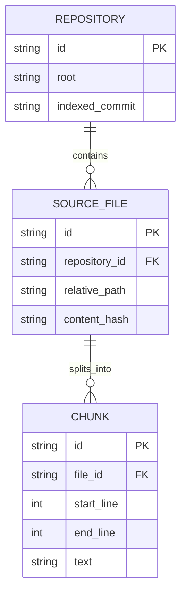
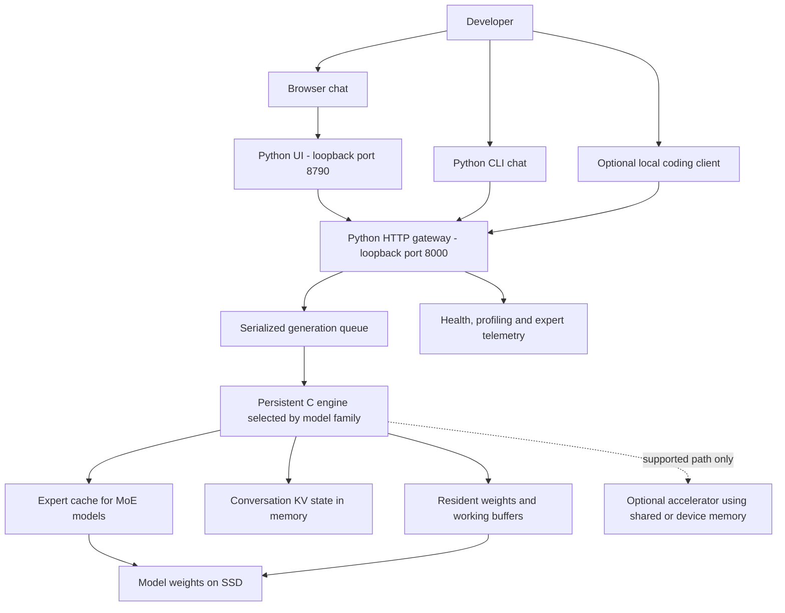
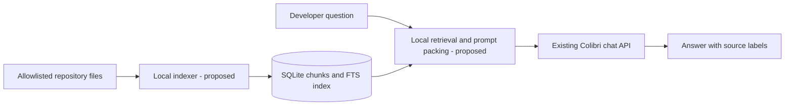
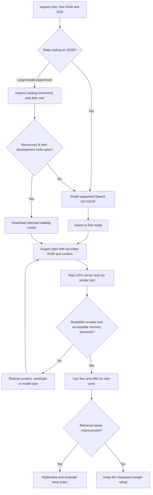
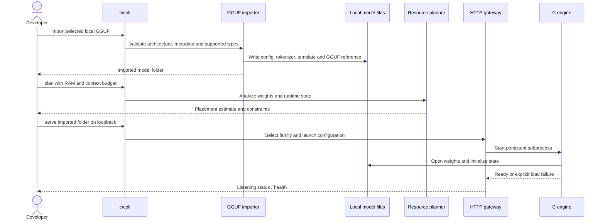
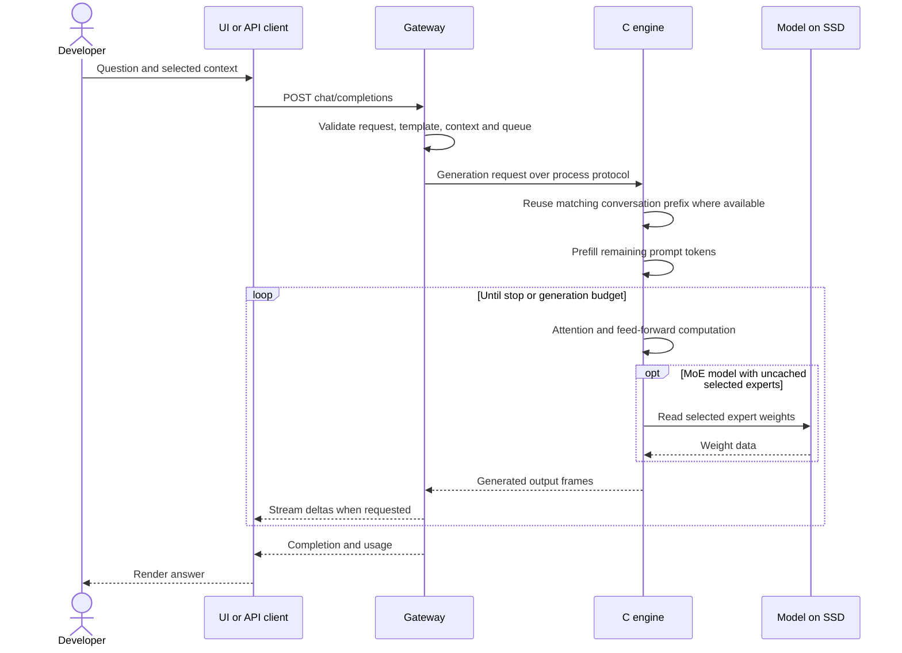
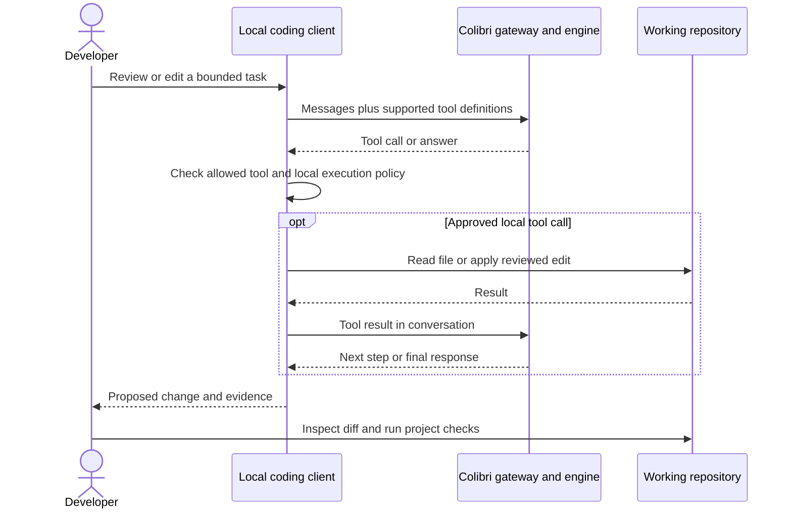

# Colibri starter: a local coding assistant on a 16GB Mac

Written on 2 November 2026 against checkout `0a5504a1` (v2.1.0). Commands below run from the repository root unless a step says otherwise.

## Table of contents

1. [Principal developer assessment](#1-principal-developer-assessment)
2. [What this project implements](#2-what-this-project-implements)
3. [Models for a 16GB Mac](#3-models-for-a-16gb-mac)
4. [Install and run on macOS](#4-install-and-run-on-macos)
5. [Daily coding, reviews, architecture and reasoning](#5-daily-coding-reviews-architecture-and-reasoning)
6. [Local RAG](#6-local-rag)
7. [HLD: high-level design](#7-hld-high-level-design)
8. [LLD: detailed request sequences](#8-lld-detailed-request-sequences)
9. [Implementation and rollout plan](#9-implementation-and-rollout-plan)
10. [Operations and troubleshooting](#10-operations-and-troubleshooting)
11. [Evidence and validation boundaries](#11-evidence-and-validation-boundaries)

## 1. Principal developer assessment

Colibri is a local model inference runtime. Python provides its command line, hardware detection, installation, HTTP gateway and browser interfaces. C engines execute the models. You supply model weights separately.

Its distinguishing feature is running mixture-of-experts (MoE) models with some weights in RAM and other experts on SSD. A router selects experts for each token. A cache keeps frequently used experts in memory. This reduces the RAM needed to start a large model, but reading experts from SSD can make generation slow. It does not eliminate the model download or make a 744B model as fast as a small model.

**My recommendation for your laptop:** begin with **Qwen3-4B Q4_K_M**, one running model, a **4,096-token context**, the CPU backend and the supplied Python chat UI. Keep your editor and normal development tools open when evaluating it. Try a larger coding model only after measuring that baseline. Small models can draft code and identify useful review leads; validate their suggestions with the compiler, tests and source inspection.

The 16GB figure is shared system memory on Apple Silicon, not 16GB exclusively available to inference. macOS, your IDE, browsers, databases, model weights, working buffers and conversation state all compete for it. The Mac chip was not specified: Apple Silicon and Intel instructions are separated below.

Use the native macOS path first. Docker Desktop adds a Linux VM and memory overhead, and is unnecessary for this setup. Node, React, Rust, PostgreSQL, Redis and a hosted AI account are not required for the Python UI and C inference path.

## 2. What this project implements

| Component | Role | Source entry point |
|---|---|---|
| Launcher | Setup, import, planning, chat, serve, UI and lifecycle commands | `c/coli:4038` |
| One-step setup | Detect hardware, choose/build an engine, download weights and save launch configuration | `start-here.sh:16`, `c/setup_flow.py:2367` |
| Download catalog | Model IDs, download repositories, estimated disk and RAM requirements | `c/setup_catalog.py:64` |
| Family registry | Match model metadata to an engine and its capabilities | `c/family_registry.py:106` |
| Resource planner | Estimate model, context, cache and accelerator placement | `c/resource_plan.py:3406` |
| C engines | Token generation, attention, expert routing and weight access | For this guide: `c/qwen36.c`, build target `c/Makefile:1439` |
| HTTP gateway | Validate requests, format prompts, run a persistent engine and stream replies | `c/openai_server.py:6792`, `c/openai_server.py:10272` |
| Python UI | Chat and monitoring, proxy to the gateway; no frontend build required | `ui/server.py:201`, `ui/index.html` |
| Optional React UI | Separate Vite application | `web/README.md:1` |
| Optional desktop UI | Tauri shell around the React UI; engine remains external | `desktop/README.md:1` |
| Setup MCP server | Let an external assistant detect, install and manage Colibri | `c/mcp_server.py`, `docs/MCP_SERVER.md` |

Important capability boundaries:

- The gateway implements OpenAI-style chat/completions and Anthropic-style messages. API compatibility is a supported subset, not a promise that every hosted API feature works. See `c/openai_server.py:7701` and [API details](docs/api.md).
- The Python UI also translates Responses API requests into chat requests through `ui/responses_shim.py:1`. It is a compatibility layer, not a hosted model or a complete Responses API implementation.
- A model may return tool calls. Your coding client executes tools and sends results back. The C engine does not itself edit your repository or run your tests.
- Chat file attachments supply text to the prompt (`c/coli:4130`). They do not create a searchable repository index.
- There is no public `/v1/embeddings` route in the inspected gateway. `c/qwen36_embedding.h:1` handles the model's internal token embedding table; it is not a document embedding API.
- The inspected starter path does not provide an end-to-end repository RAG index, vector store or training pipeline. Section 6 distinguishes a usable file-retrieval workflow from a proposed indexed extension.

## 3. Models for a 16GB Mac

### Practical shortlist

These are fit recommendations, not measured performance results on your laptop. The file size is not the total runtime RAM requirement. Quantization reduces weight precision and memory, with possible quality loss.

| Model | How to load it | Storage / memory basis | Recommendation |
|---|---|---|---|
| **Qwen3-4B Q4_K_M** | Manual GGUF import, `qwen3` architecture on the `qwen36` engine | Official file listing: about 2.5GB; runtime needs additional memory | Start here for explanations, small code changes, review assistance and bounded reasoning |
| Other small Qwen3 dense GGUFs, e.g. 0.6B | Manual GGUF import | Size depends on the chosen quantization | Useful for an engine smoke test; lower quality is a real limitation |
| Qwen3-Coder-30B-A3B | Catalog ID `qwen3-coder-30b` | Catalog: 19.4GB download; 8GB minimum / 18GB comfortable system RAM | Optional coding experiment with a partial expert cache; no thinking mode |
| Qwen3.6-35B-A3B | Catalog ID `qwen36-35b` | Catalog: 23.1GB download; 10GB minimum / 20GB comfortable system RAM | Optional thinking/tool-use experiment; not a comfortable full-cache choice for a busy 16GB laptop |
| OLMoE 7B | Manual preparation/import; see README | README: 14GB source, about 7GB after int8 conversion, 8GB RAM | Educational alternative, not my first daily coding choice |

The Qwen3-4B choice follows the importer's implemented `qwen3` architecture support and the small weight file. It has **not** been end-to-end qualified with that exact file on this laptop in this documentation task. Validate it with the smoke test below before relying on it.

The official [Qwen3-4B model card](https://huggingface.co/Qwen/Qwen3-4B-GGUF) describes thinking and non-thinking operation. Its [file list](https://huggingface.co/Qwen/Qwen3-4B-GGUF/tree/main) contains `Qwen3-4B-Q4_K_M.gguf`. Both were checked when writing this guide. Download only the selected variant, not the whole multi-quantization repository.

### Supported does not mean suitable for this laptop

The checkout also supports GLM-5.2/5.3, GLM-5.3-Flash, Mistral-Large-4, Inkling, Kimi K3, DeepSeek V4/V4.1, MiMo, Qwen3.8-Flash-Next, Flint, Muse Spark Open, LFM3-VL, Qwen-Image and decision models. Exact architecture, format, vision and backend support vary. The authoritative lists are [GGUF support](docs/gguf.md), [README model tables](README.md#which-model-for-my-machine) and the family registry.

Do not start daily work on this laptop with GLM's roughly 419–429GB catalog downloads or Kimi's roughly 1.56TB download. Catalog minimum RAM is a startability threshold, not a latency guarantee or room for your development stack. Some other families already exceed 16GB minimum RAM. Image generation and decision models serve different tasks from a coding chat model.

GGUF is a file format, not universal compatibility. An arbitrary Llama, embedding model or older Qwen Coder GGUF does not become supported just because its filename ends in `.gguf`. `coli import` checks architecture and block types.

### Memory and disk starting policy

- Keep one model process and one KV conversation slot. A KV cache stores attention state and grows with context; it is separate from an MoE expert cache.
- Begin at 4K context and at most 512 output tokens for smoke tests. Increase output allowance for reasoning only after confirming memory headroom.
- Aim to leave roughly 6–8GB for macOS and your active development tools. This is a planning target, not a measured model memory footprint or a hard operating-system limit.
- For the 2.5GB starter file, reserve at least 10GB free for weights, metadata, build outputs and working room, plus normal macOS free space. Larger catalog models need much more.
- Use the internal SSD first. An external SSD can hold weights, but sustained and random-read performance affects streamed experts.
- Watch Activity Monitor's **Memory Pressure** and growing swap usage during a real task. Reduce context or model size if the editor becomes sluggish. Do not compensate by increasing thread counts blindly.

## 4. Install and run on macOS

### Step 1: inspect the machine

Run in a normal Terminal on your Mac:

```bash
uname -m
sw_vers
sysctl -n hw.memsize
df -h .
python3 --version
xcode-select -p
```

`arm64` means an Apple Silicon process. If an Apple Silicon Mac reports `x86_64`, check whether Terminal is running under Rosetta and use native tools. A genuine Intel Mac can follow the CPU path; do not use the experimental Apple Silicon Metal instructions for it.

### Step 2: prepare the native tools

If Command Line Tools are missing, run this once and finish the installer before continuing:

```bash
xcode-select --install
```

With Homebrew already installed, install missing prerequisites:

```bash
brew install python libomp
```

Use Python 3.10 or newer. `libomp` enables multithreaded Apple clang builds; without it this Makefile can fall back to a much slower single-threaded build. A full Xcode installation is not required for the CPU path.

In your existing Colibri checkout:

```bash
python3 -m venv .venv
source .venv/bin/activate
python3 c/coli --help
make -C c qwen36 -j2
```

The core CLI and Python UI use the standard library. There is no need to install PyTorch or Transformers for this path. Calling `python3 c/coli` directly also avoids relying on the pip wrapper's ability to locate the sibling `c/` source directory.

### Step 3: choose exactly one model installation path

#### Path A — recommended small GGUF

Open the verified [official file list](https://huggingface.co/Qwen/Qwen3-4B-GGUF/tree/main), download **only** `Qwen3-4B-Q4_K_M.gguf`, and place it in `~/colibri-models`. This is the online provisioning step; subsequent local inference does not require the Hub.

```bash
mkdir -p "$HOME/colibri-models"
mv "$HOME/Downloads/Qwen3-4B-Q4_K_M.gguf" "$HOME/colibri-models/"
python3 c/coli import \
  "$HOME/colibri-models/Qwen3-4B-Q4_K_M.gguf" \
  --out "$HOME/colibri-models/qwen3-4b" --mode link
python3 c/coli doctor --model "$HOME/colibri-models/qwen3-4b"
python3 c/coli plan --model "$HOME/colibri-models/qwen3-4b" \
  --ram 8 --ctx 4096 --gpu none --json
```

Link mode writes configuration, tokenizer/template information and `gguf.json`; it reads the original GGUF in place. Keep that weight file at its imported location. Moving or deleting it breaks the link. Do not rename a different architecture to this filename.

`--ram 8` supplies an 8GB planning budget. It is **not** an enforced process RSS limit. If the planner refuses the budget, first inspect its explanation and reduce context or model size rather than assuming swap makes it safe.

#### Path B — optional larger coding model from the catalog

First inspect what the setup believes fits:

```bash
python3 c/coli setup --list --json
```

If you deliberately accept the approximately 19.4GB download and tighter memory conditions:

```bash
python3 c/coli setup --model qwen3-coder-30b \
  --backend cpu --ctx 4096 --no-start
```

This builds/downloads and saves a managed configuration. `python3 c/coli start` uses that saved setup configuration. `status`, `stop` and `logs` manage that lifecycle. Manual GGUF import and a foreground `serve` command in Path A do not automatically register the same managed installation.

For a controlled manual launch of the downloaded coder model, substitute its folder for the Path A folder below, use a distinct model ID such as `local-coder`, and add `--auto-tier --ram 8`. Inspect the plan and logs; do not copy the 35B model's expert-cache cap blindly between families.

### Step 4: start the API, then the UI

Terminal A, from the repository root with the virtual environment active:

```bash
python3 c/coli serve \
  --model "$HOME/colibri-models/qwen3-4b" \
  --model-id local-qwen3-4b \
  --host 127.0.0.1 --port 8000 \
  --gpu none --ram 8 --ctx 4096 --kv-slots 1 --ngen 1024 --no-think
```

Wait for readiness in the terminal. Keep it open. Terminal B, from the same checkout:

```bash
source .venv/bin/activate
python3 c/coli ui --backend http://127.0.0.1:8000
```

The UI opens at `http://127.0.0.1:8790`. The API is at `http://127.0.0.1:8000/v1`. These loopback addresses come from the implemented defaults. `coli web` is the older dashboard; `coli ui` is the separate Python chat UI. Neither needs `npm install`.

### Step 5: verify an actual model response

```bash
curl --fail http://127.0.0.1:8000/health
curl --fail http://127.0.0.1:8000/v1/models
curl --fail http://127.0.0.1:8000/v1/chat/completions \
  -H 'Content-Type: application/json' \
  -d '{"model":"local-qwen3-4b","messages":[{"role":"user","content":"Write a Python function that adds two integers. /no_think"}],"max_tokens":512,"temperature":0.2,"stream":false}'
```

Require readable output, a completion result and no engine failure in Terminal A. Then test your own language with one small function and its tests. A healthy HTTP server alone does not prove the weights loaded or inference worked.

To use terminal chat against that same running model:

```bash
python3 c/coli chat --attach http://127.0.0.1:8000
```

### Apple GPU acceleration: a later experiment

The one-step setup selects CPU, Vulkan or CUDA; it does not offer a `--backend metal` switch. CUDA is not the Mac path. Metal exists as an opt-in experimental backend, but its coverage differs by engine and weight layout.

In particular, the Qwen engine's Metal integration in this checkout includes a special qpack routed-expert path (`c/Makefile:1423`, `c/qwen36.c:9612`). Building with `METAL=1` does not establish that the ordinary small dense GGUF recommended here executes on the GPU. Do not promise a Metal speedup from the build flag alone.

For research into supported Metal paths, read [Metal](docs/metal.md), [Qwen implementation notes](docs/qwen36.md) and the corresponding source before building. Verify runtime dispatch and compare measured latency with the same prompt and weights. Unified GPU memory remains part of the same 16GB pool. The project's published high-memory Mac results are not benchmarks for this laptop.

## 5. Daily coding, reviews, architecture and reasoning

### Coding and review without an IDE plugin

Start with files you deliberately select. `--file` and the interactive `/file PATH` command are already implemented:

```bash
python3 c/coli chat --attach http://127.0.0.1:8000 --file README.md
```

For a review in a target repository, select a real base ref after checking your branch. This example reviews committed changes since the merge base with `main`; use the appropriate base for that repository:

```bash
git diff --no-ext-diff main...HEAD > /tmp/colibri-review.diff
```

For uncommitted tracked changes use `git diff HEAD` instead. Neither command includes untracked files. Inspect the resulting text before sending it, then attach it using the Colibri CLI from this checkout:

```bash
python3 c/coli chat --attach http://127.0.0.1:8000 \
  --file /tmp/colibri-review.diff
```

Use this review prompt:

> Review the attached diff for correctness, authorization, injection, data loss and expensive repeated work. Return only findings supported by the supplied code. For each, give severity, file and line, a concrete failure scenario and a minimal fix. List missing context separately. Do not claim tests ran.

A diff can expose source code or credentials already present in it; inspect it first. A small context cannot hold a large PR. Review one logical change at a time and add the relevant callers, authorization rules and tests.

### Architecture and reasoning

For architecture, attach requirements, actual module boundaries, key schemas and constraints. Ask:

> Given these files and a 16GB local deployment constraint, describe the current request path, identify evidence for each component, compare two feasible designs and propose the smallest migration. Include a Mermaid sequence diagram. Separate facts from assumptions and unresolved decisions.

For harder reasoning, allow more output and request the model's thinking mode through the gateway, for example `"enable_thinking":true` in a chat request. The gateway has family-specific thinking handling; verify the selected model's response rather than assuming every model implements it. Qwen3-Coder-30B has no thinking mode. A 1,024-token server ceiling can be consumed by reasoning before an answer appears; increase `--ngen` deliberately or use non-thinking mode for short edits. The total prompt, reasoning and answer must still fit the context.

### IDE integration contract

You can use an existing coding client that supports a custom local endpoint. Configure its relevant fields as follows; exact setting names depend on that client:

| Field | Value |
|---|---|
| API dialect | OpenAI chat completions |
| Base URL | `http://127.0.0.1:8000/v1` |
| Model ID | `local-qwen3-4b`, or the exact ID from `/v1/models` |
| API key | None if the client permits; a non-secret placeholder only if required by the client and gateway auth is off |
| Context | 4,096 initially; reduce client-supplied history accordingly |
| Features | Start with manual chat and file context; enable tools only after a successful tool round trip |

If a client requires the Responses API, the supplied UI exposes its shim at `http://127.0.0.1:8790/v1/responses` while the UI server runs. It is not a native `/v1/responses` endpoint on port 8000. The built-in UI agent launcher documents Windows/WSL support; do not assume its one-click launch works on macOS. Configure a Mac client manually.

Turn off cloud fallback, hosted embeddings, web search and remote telemetry in whichever client you choose. A local inference URL does not force an entire IDE extension to operate offline. Confirm each feature's network behavior. This guide does not install or certify a particular editor extension.

### A manageable daily loop

1. Start the foreground server and UI. Reuse the running engine instead of loading one per tool.
2. Select a small task and the relevant files. Ask for a plan or a narrow patch.
3. Inspect the patch, apply it on a working branch and run the project's own checks.
4. Ask for a review using the resulting diff and necessary context.
5. Keep accepted architecture decisions in repository documentation; model chat memory is not the authoritative record.
6. Stop both foreground terminals with Ctrl+C when finished. Avoid leaving parallel model processes consuming RAM.

## 6. Local RAG

RAG means **retrieve relevant material, then give that material to the model to answer from**. It does not require training the model. Retrieval quality and citations matter as much as generation.

### Available now: local search and selected-file context

For day-to-day work on one repository, begin with text search and explicit attachments. In your target repository, search tracked files for concrete symbols or terms:

```bash
git grep -n -I -E 'authorization|tenant|permission' -- '*.cs' '*.ts' '*.tsx' '*.md' \
  > /tmp/colibri-context.txt
```

Inspect that file and remove irrelevant or sensitive matches. No matches makes `git grep` return 1. Then attach the search results and the small source files needed to understand them through `coli chat --file`. Ask the model to cite the supplied `path:line` labels and to state when evidence is insufficient. Search results alone often lack enough surrounding code.

This is a manual retrieval workflow with local generation. It is usable today but is not an automatic semantic repository assistant. It sends text, not vectors, to Colibri.

### Proposed next step: indexed retrieval

The following service is a design to implement separately, not an existing Colibri feature:

1. Choose an explicit repository root. Enumerate tracked, allowed source and documentation files; exclude secrets, `.env*`, generated outputs, dependencies, binaries and private key material. Do not follow symlinks outside the root.
2. Split text by function/heading where possible, otherwise by bounded line windows. Retain repository ID, relative path, start/end lines and content hash. A starting chunk size is 300–600 tokens with modest overlap; measure retrieval results rather than treating this as universal.
3. Start with SQLite FTS5 full-text search on disk. It avoids another model and server on a 16GB laptop. Confirm your Python SQLite build supports FTS5 before using it.
4. Retrieve a few chunks, print source labels and pack only what fits. With 4K context, start with about 1–1.5K retrieved tokens, leaving room for instructions, question, history and up to 1K answer tokens. Use the actual model tokenizer when implementing a strict budget.
5. Call Colibri's chat endpoint with those chunks as quoted reference data. Require source citations and an explicit insufficient-evidence response. Retrieved instructions must not authorize tool execution.
6. Reindex changed files by hash and remove deleted files. Cite the indexed commit/hash so stale evidence is visible.
7. Only if lexical search misses useful questions, add a separately qualified **local embedding model/runtime**, incremental vector storage and hybrid search. Colibri's current text endpoint does not supply these embeddings. Pre-download all embedding artifacts and disable remote lookup/fallback before offline use.

For this machine, avoid simultaneously running multiple chat models, a heavyweight vector service, a reranker and your full application stack. Begin with one generation model plus disk-backed lexical retrieval.

Proposed metadata model; SQLite FTS is a searchable projection of `CHUNK`. No such database is created by the starter commands:



## 7. HLD: high-level design

### Implemented runtime

All runtime boxes below can reside on the Mac. Downloading packages/weights is a separate online provisioning activity. The optional web-search feature and model catalog search contact external services; leave them unused during offline work.



The gateway and engine are different processes, communicating through the engine's line protocol and output frames. The browser sees HTTP/streamed events. The gateway keeps the engine loaded and serializes generation; concurrent HTTP requests do not imply parallel model execution. Dense Qwen3 has no routed-expert cache: all transformer layers are used for each token. MoE placement applies when using an MoE model.

### Proposed RAG addition



### Setup decision flow



## 8. LLD: detailed request sequences

### LLD 1 — GGUF import and server startup

Code: `c/coli:3914`, `c/tools/gguf_import.py:1`, `c/coli:3431`, `c/openai_server.py:6792`.



### LLD 2 — chat and token streaming

Code: `c/openai_server.py:6259`, `c/openai_server.py:6792`, `c/openai_server.py:7701`; engine wire format: [serve protocol](docs/serve_protocol.md).



### LLD 3 — coding tools belong to the client

This is the integration contract for a tool-capable model and client. The example client is optional; macOS one-click launch is not assumed.



### LLD 4 — proposed indexed RAG query

This sequence requires the separate extension described in section 6. The current Colibri gateway supplies only the generation step.

```mermaid
sequenceDiagram
    actor Dev as Developer
    participant R as Local retrieval app - proposed
    participant DB as SQLite FTS and chunks - proposed
    participant GW as Existing Colibri chat API
    Dev->>R: Question and allowed repository
    R->>DB: Search relevant chunks within repository
    DB-->>R: Text, paths, lines and source hashes
    R->>R: Select evidence within token budget
    alt Evidence found
        R->>GW: Question plus quoted evidence and citation labels
        GW-->>R: Generated answer
        R-->>Dev: Answer plus source labels and index version
    else No evidence
        R-->>Dev: No matching evidence; refine question or add files
    end
```

## 9. Implementation and rollout plan

This is a staged plan for making the laptop useful. **This change adds documentation; it does not install models or implement the proposed retrieval service.**

| Phase | Plain-English action | What already exists | Done when |
|---|---|---|---|
| 0 — baseline | Record chip, real memory headroom, SSD space and current commit | Hardware probe, catalog and planner | You know the resources available with your normal tools open |
| 1 — first local answer | Build `qwen36`, import the 4B GGUF, start the server and UI | Importer, C engine, gateway, UI | Model answers a smoke prompt and a real small coding task |
| 2 — daily workflow | Use selected source, diffs and written architecture decisions | CLI attachments, compatible API | Five representative tasks complete with acceptable latency and verified changes |
| 3 — client integration | Point your chosen local coding client at loopback; test one tool cycle | Tool-call API; client execution remains external | File read/edit/test results are correct and no cloud fallback occurs |
| 4 — retrieval baseline | Search tracked files and attach relevant source | Existing Git search plus CLI attachments | Ten repository questions have inspectable source-backed answers |
| 5 — indexed lexical RAG | Add scoped ingestion, chunk metadata, SQLite FTS and prompt packing | Proposed extension; not shipped here | Reindex, deletion, citations, source scoping and no-evidence cases work offline |
| 6 — optional semantic retrieval | Add a small local embedding runtime only if evaluation justifies it | Proposed extension; embeddings endpoint absent here | Retrieval improves on the same question set within memory limits |
| 7 — optional larger model | Test Qwen3-Coder or Qwen3.6 with a partial expert cache | Catalog install and resource planning | It improves useful task quality enough to justify its latency and memory cost |

Use a simple scorecard: task, model/file/quantization, commit, context, prompt size, time to first token, total time, tokens per second, memory pressure, swap growth, correctness and citation accuracy. Compare cold and warm runs separately. Do not transfer Windows/Linux/NVIDIA benchmark numbers to this Mac.

Acceptance checks should include a small refactor with passing tests, a seeded bug the review catches, an architecture question with source references, an answerable repository question and a deliberately unanswerable one. For tools, verify the local client actually executes the requested operation and returns its result; emitting JSON alone is not successful tool use.

## 10. Operations and troubleshooting

### Keep runtime local

Package and weight downloads require network access initially unless you transfer them from another machine. After provisioning, keep weights, tokenizer, templates and any retrieval artifacts on disk. Test a real chat and retrieval task with networking disconnected.

Bind gateway and UI to `127.0.0.1`. Leave UI web search off; do not use Hub/catalog search while testing offline. The optional UI web search deliberately makes external requests. Disable remote MCP servers and client fallbacks if using a coding agent. Files, browser history, generated context, logs and any future index can still contain private data locally; exclude them from source control and cloud-synced folders as needed.

Gateway API-key protection is available through `COLI_API_KEY`. If enabled, configure the same value in clients and send `Authorization: Bearer ...` in curl checks. A placeholder is not authentication when a real gateway key is configured. Do not commit keys or put private credentials into model context.

### Start and stop correctly

- Manual `serve` / `ui` used here: rerun the terminal commands to start; Ctrl+C in each owning terminal to stop. Look at those terminals for logs.
- Managed `coli setup` installation: use `python3 c/coli start`, `python3 c/coli status --json`, `python3 c/coli logs -n 50` and `python3 c/coli stop`.
- Do not start a second engine just because you open another chat. Attach to the existing gateway.
- The UI's model switching discovers processes through `/proc` and documents Linux/WSL support. On macOS, restart the foreground gateway manually with the selected folder.

| Symptom | First check / action |
|---|---|
| Single-thread warning or very slow CPU inference | Confirm `libomp` is installed and rebuild; inspect compiler/link output for OpenMP |
| Model import refuses the file | Read the architecture/type error; compare with `docs/gguf.md`; do not bypass it |
| Server starts but requests fail | Read the first engine load error and run `doctor` for the exact model folder |
| Request rejected for context length | Reduce attached text/history or output budget; use smaller review batches |
| Reasoning streams but no final answer | Check output/context exhaustion; try non-thinking mode or allow more output within available context |
| IDE cannot connect | Verify `/v1/models` with curl, base URL dialect, exact model ID and auth; Responses clients need the UI shim |
| Port already in use | Check the process already serving that port before starting another; keep client/UI ports consistent |
| Memory pressure or growing swap | Stop duplicate models and heavy unused apps; lower context or model size |
| Model folder no longer works after moving weights | Link-mode metadata still references the original GGUF; reimport its new location |
| Hardware probe reports null or incomplete data | Run the native inspection commands in a normal Terminal; restricted automation may block system probes |
| A catalog model is marked as fitting but feels unusable | Fit is not throughput; measure disk reads, memory and real task latency; return to the small model |

After an update, inspect upstream changes and rebuild the engine you actually use. For the manual starter path that is `make -C c qwen36 -j2`; rerun health and generation checks before trusting the new version. Record the previous Git commit and keep the previous model files so you can reproduce a working configuration without another download.

## 11. Evidence and validation boundaries

The architecture above was checked against this checkout's CLI, setup catalog, family registry, resource planner, GGUF importer, Makefile, gateway and UI code. The [upstream project](https://github.com/JustVugg/colibri) and official Qwen model/file pages were also consulted. Runtime behavior is governed by the checked-out implementation when upstream documentation changes.

Validation during this documentation task:

- Checked actual `import`, `serve` and `plan` CLI help for the documented flags.
- Checked `doctor`, `ui`, `chat` and `setup` help, all fenced shell examples for shell syntax, and local document link targets. The eight Mermaid blocks were not visually rendered.
- Built the CPU `qwen36` engine successfully with Apple clang and Homebrew `libomp`.
- Ran the hardware probe read-only. Its restricted environment could not resolve total RAM or all CPU probes, so its partial results are not a hardware qualification for your laptop.
- The GGUF import unittest module was skipped because NumPy is absent in the active Python environment. This is not a passing import/inference test.
- No model weights were downloaded. No 4B/30B model response, Mac GPU acceleration, offline network isolation or IDE integration was executed as part of creating this guide.
- The RAG index and semantic retrieval phases are a proposed implementation plan, not completed features.

Source locations for deeper reading:

| Question | Code / documentation |
|---|---|
| How does the one-step launcher delegate? | `start-here.sh:16`, `colibri/cli.py:13` |
| Where do model sizes and RAM thresholds come from? | `c/setup_catalog.py:16`, `c/setup_catalog.py:64` |
| How does resource planning work? | `c/resource_plan.py:3406` |
| How is a GGUF linked without a second weight copy? | `c/tools/gguf_import.py:1`, `docs/gguf.md:1` |
| How does the CLI start the API? | `c/coli:3431` |
| Where is the persistent subprocess managed? | `c/openai_server.py:6792` |
| What are the text API routes? | `c/openai_server.py:7701` |
| Where are localhost and gateway startup configured? | `c/openai_server.py:10272`, `c/coli:4138` |
| Where does Responses translation happen? | `ui/server.py:178`, `ui/responses_shim.py:1` |
| What leaves the machine through UI features? | `ui/README.md`, `ui/web.py`, `ui/models.py` |
| What does the C gateway protocol look like? | `docs/serve_protocol.md` |
| Why not assume full Mac GPU support? | `docs/metal.md`, `c/Makefile:1423`, `c/qwen36.c:9612` |
